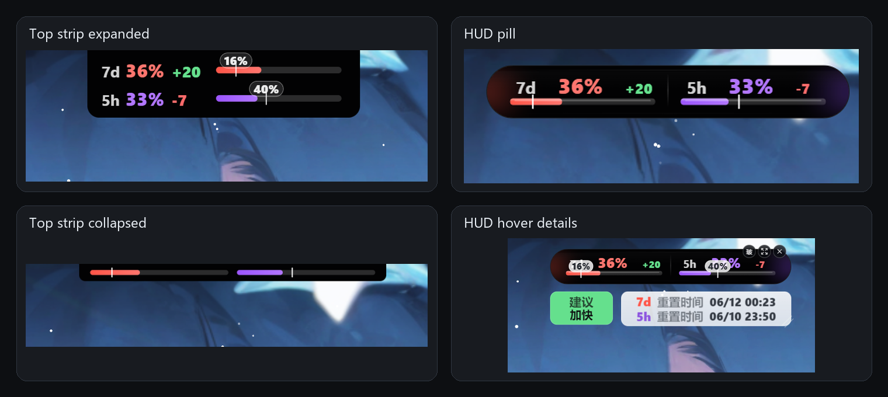

# Codex Quota Widget · ChatGPT 用户的 Codex 用量监控

Codex 用量监控是一款统计 OpenAI Codex 本机会话的 Windows 桌面工具。悬浮窗可以一直挂在屏幕顶边，显示 5 小时和 7 天还剩多少额度，以及比匀速使用多剩或少剩多少。要查某个项目的花费，或看哪条线程用得最多，打开仪表盘按时段筛选即可。

[下载 v0.3.2 Windows 便携版](https://github.com/stupdada/codex-quota-widget/releases/tag/v0.3.2)

关键词：ChatGPT、ChatGPT Work、OpenAI Codex、Codex 额度、Token 用量。

## 悬浮窗

紧凑 HUD 可以放在桌面任意位置。拖到屏幕顶边会收成细条，鼠标移上去再展开，两种布局一共四种形态。想临时腾出屏幕空间，可以用托盘或自己设置的全局快捷键隐藏悬浮窗。

进度条的彩色部分是实际剩余。**白色刻度**标出按时间匀速使用时，此刻应该剩多少。比如 7d 还剩 59%，白线在 67%，这时比匀速基准少了 8 个百分点。5h 和 7d 各有自己的刻度。

## 仪表盘里能查什么

- **哪个项目、哪个线程用得最多。** 选今天、当前 5h／7d 周期或自定义时段，在「费用构成」里按项目或线程看排行。点开具体条目，还能查用量和费用明细。
- **哪段时间消耗突然上去了。** 费用速率图以美元/小时显示，设一条阈值就能在峰值图里找超出的时段。想看 Token，切到对应页签，可以按时段看总量、非缓存输入和输出。
- **这轮额度用得比匀速快还是慢。** 额度图把 5h、7d 的实际剩余和 7d 理想线画在一起。旁边的「5h 等价」「7d 等价」估算的是整个额度周期的美元等价；页首的「预计费用」只统计你选的时段。实际扣费以账户账单为准。

## 截图

### 图 1 · 悬浮窗的四种形态

图为 v0.2.0 实拍，展示 HUD 与顶部细条各自的收起和悬停展开状态。当前版悬浮窗的白色刻度表示线性理想剩余。



### 图 2 · v0.3.2 仪表盘

**额度剩余趋势。** 红线是 7d 实际剩余，虚线是 7d 理想参考。右侧可看当前账户额度、重置倒计时和周期美元等价。


**费用速率趋势。** 蓝色峰值图显示用量集中在什么时候，橙线是自设的费用速率阈值。项目和线程明细在图表下方的「费用构成」。


### 原项目截图

下面是 [codex-led-widget](https://github.com/xicunwus2025-sys/codex-led-widget) 的界面，保留作项目沿革参考。

<p align="center">
  
  
  
</p>

<p align="center">
  
  
</p>

## 下载和使用

1. 从 [Releases](https://github.com/stupdada/codex-quota-widget/releases) 下载 `CodexTokenDashboard.exe`。需要 Windows x64 和本机已安装、登录并使用过的 Codex。
2. 双击运行。便携版自带本机统计后端。可把 HUD 拖到屏幕顶边，或在仪表盘「更多 → 快捷键」设置全局开关。
3. 在仪表盘选择 5h 周期、7d 周期或自定义时段，再按项目筛选。额度栏显示「未读取」时，表示本机暂时缺少对应周期的额度观测。

会话统计和额度历史在本机处理。当前便携版没有代码签名，Windows 可能显示未知发布者。

## 源码构建

在 Windows x64 上安装 Node.js 和 64 位 Python 3.11–3.13，然后在仓库根目录执行：

```powershell
python -m pip install -r backend/source/requirements-desktop.txt
npm ci
npm run build
```

便携版输出到 `dist/CodexTokenDashboard.exe`。开发时可运行 `npm run build:backend` 后执行 `npm run dev`，用 `npm test` 验证桌面端逻辑。

## 项目来源

额度悬浮窗源自 [xicunwus2025-sys/codex-led-widget](https://github.com/xicunwus2025-sys/codex-led-widget)。[历史版本文档和截图](https://github.com/stupdada/codex-quota-widget/tree/v0.2.3#readme)

MIT License
