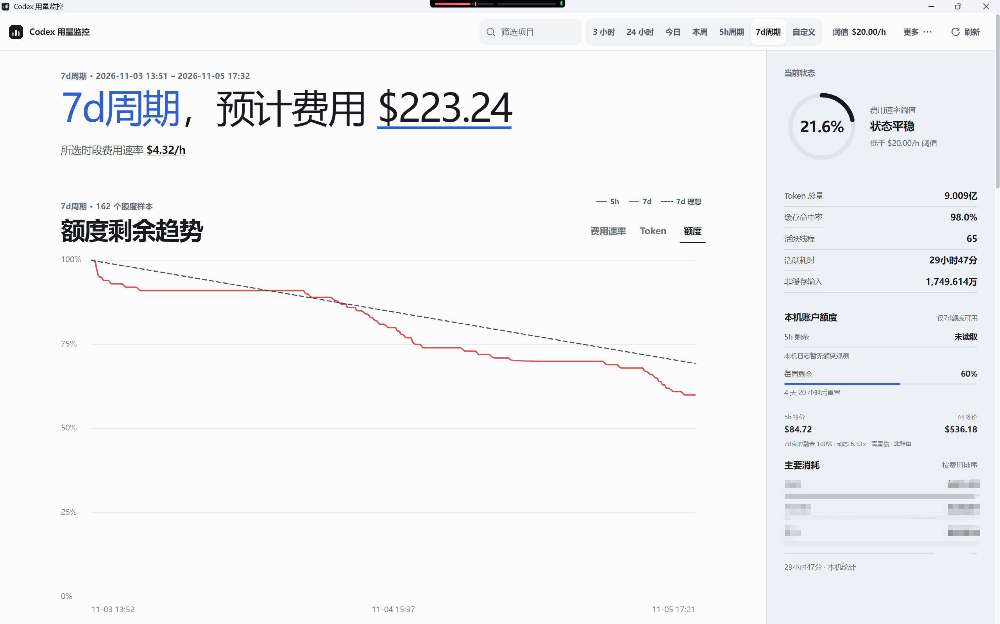
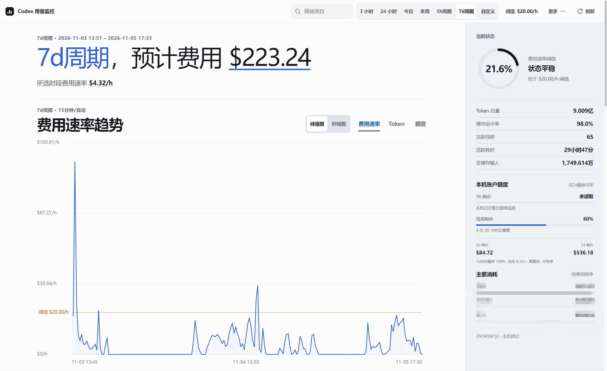
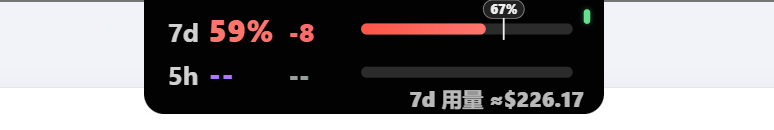
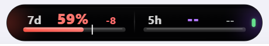

# Codex 用量监控

在 Windows 上看 Codex 还剩多少额度、什么时候重置，以及哪些项目消耗最多。平时用置顶悬浮窗扫一眼，需要复盘时打开仪表盘看趋势和明细。

**当前分支是 v0.3.2 开发版。** 它把原来的 Codex 额度小组件与 Token Dashboard 合进了同一个应用。可从本分支源码构建，新版功能以本页为准。[GitHub Releases（旧版 v0.2.3）](https://github.com/stupdada/codex-quota-widget/releases/tag/v0.2.3)



*额度趋势实拍。红线是 7 天实际剩余，虚线是按时间均匀使用时的参考线。右侧是当前账户额度和重置倒计时。*

## 新版亮点

- **按项目查用量。** 支持最近 3 小时、24 小时、今天、本周、当前 5 小时／7 天额度周期和自定义时段。可以按项目筛选，查看 Token、缓存命中率、活跃线程、活跃耗时和消耗排行。
- **定位费用尖峰。** 在费用速率、Token 和额度三种趋势之间切换。费用速率支持峰值图和折线图，也可以设置每小时阈值，对照查看什么时候用量集中。
- **回看额度消耗节奏。** 对照 5 小时、7 天的实际剩余和 7 天理想线；额度历史保存在本机，最长保留 180 天。右侧同时显示当前可读取的额度和重置倒计时。
- **悬浮窗和仪表盘共用一套数据。** HUD 可以拖到屏幕顶部变为细条，两种布局都能悬停展开。彩条显示实际额度，白色刻度标记理想剩余；灯效提示额度偏紧或接近耗尽。点击展开按钮即可打开仪表盘。
- **日常控制都在桌面上。** 托盘可控制悬浮窗的显示与置顶，支持调整刷新间隔和告警灯效。仪表盘和悬浮窗可以分别绑定全局快捷键，也可以手动启用一次性的「额度重置后退出 Codex」。



*费用速率实拍。蓝色峰值图用于定位用量集中时段，橙色横线是自设阈值。*

### 悬浮窗实拍

**顶部细条 · 悬停展开**。贴住屏幕顶边时收成细条，悬停后可以看剩余额度、与理想剩余的差值和所选时段的估算用量。



**紧凑 HUD · 常驻显示**。两条进度分别对应 7 天和 5 小时，白色刻度是按时间计算的理想剩余。截图中 5 小时额度还没有读取到，所以显示为「--」。



## 怎么看这些数字

- **额度百分比**来自本机可读取的 Codex 额度记录。某个周期暂时没有记录时，界面会显示「未读取」。
- **费用和 Credits**由本机会话日志估算。费用是按 API 价格换算的美元等价，实际账单以账户为准。
- **会话和历史**由本机后端处理。仪表盘和悬浮窗通过本机回环接口读取数据，额度历史存入本机 SQLite。

## 构建并运行

需要 Windows x64、Node.js、64 位 Python 3.11–3.13，以及本机已安装、登录并使用过的 Codex。用 PowerShell 克隆开发分支：

```powershell
git clone --branch dev/codex-token-dashboard https://github.com/stupdada/codex-quota-widget.git
cd codex-quota-widget
python -m pip install -r backend/source/requirements-desktop.txt
npm ci
npm run build
```

双击生成的 `dist/CodexTokenDashboard.exe` 即可运行。便携包包含 Python 后端，应用会在需要时自动启动它。日常使用时，可以把悬浮窗拖到屏幕顶边，或到仪表盘「更多 → 快捷键」设置全局开关。

### 本地开发

```powershell
npm test
npm run build:backend
npm run dev
```

桌面外壳和悬浮窗在 `src/`，Python 后端、仪表盘页面和后端测试在 `backend/source/`。

## 致谢与许可

额度悬浮窗源自 [xicunwus2025-sys/codex-led-widget](https://github.com/xicunwus2025-sys/codex-led-widget)。项目使用 MIT 许可。
